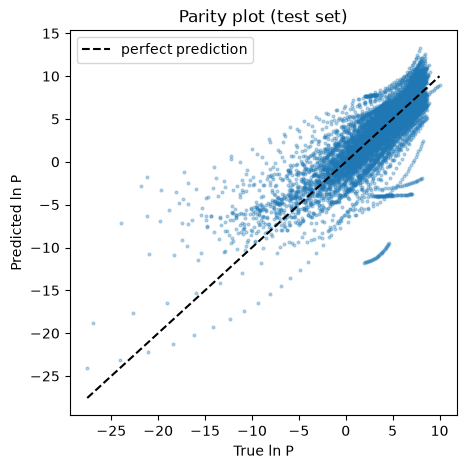
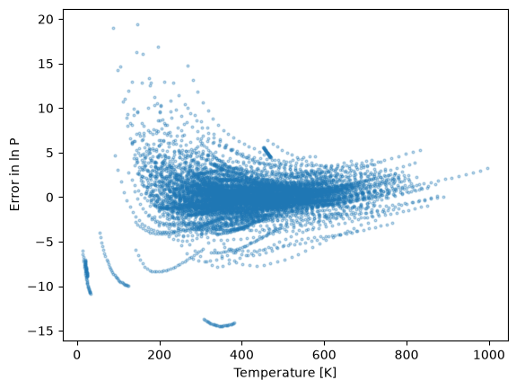

# Error Analysis: DNN for VLE prediction

Analysis of the errors of the final model (hidden size 50, best-epoch weights from early stopping) on the **test set** (8,610 rows, compounds not seen in training or validation).

## 1. Definitions

- **Error** = predicted $\ln P$ − true $\ln P$. Positive means the model over-predicts the pressure, and negative means it under-predicts.
- An error of $x$ in $\ln P$ corresponds to a factor of $e^{x}$ in the pressure (error 2 is about 7 times, error 5 is about 150 times).
- **MAE**: mean of the absolute errors. **RMSE**: square root of the mean squared error, which weights large errors more. **Bias**: mean of the signed error.
- A bias close in size to the MAE means the errors are systematic (nearly all in one direction). A bias near 0 with a large MAE means errors go in both directions.
- If RMSE is much larger than MAE, a few extreme errors dominate.

## 2. Overall test performance

| Metric | Value |
|---|---|
| MAE | 1.634 |
| RMSE | 2.516 |
| $R^2$ | 0.642 |
| MAPE (secondary) | 146.6% |

The RMSE is much larger than the MAE, so the errors are concentrated in a minority of predictions. The rest of this file looks for where they are.

## 3. Method

Test predictions were joined with the test-row metadata (name, class, subclass, temperature, true $\ln P$), and the signed and absolute errors were computed per row. Each compound has 30 rows (30 temperature points), so a class with $n$ compounds has $30n$ rows.

_```python
err = df_test[['Name', 'Class', 'Subclass', 'T', 'ln_P']].copy()
err['pred'] = y_test_pred.ravel()
err['error'] = err['pred'] - err['ln_P']
err['abs_error'] = err['error'].abs()
```_

## 4. Parity plot

__

- The dense cloud for true $\ln P$ between about 0 and 10 lies close to the line "predicted = true". This is where most of the data is.
- For true $\ln P$ below about -10, the points lie well above the line. True values reach about -27, while predictions stay around -5 to -10. The model over-predicts very low pressures.
- The thin curved streaks are single compounds, whose 30 rows trace a curve as temperature changes. A streak far from the line means one compound is badly predicted at all temperatures. One streak at true $\ln P$ about 2 to 5 is predicted at about -12 to -9.

## 5. Error against temperature

_._

- Between about 400 and 700 K the errors are small and centered near 0.
- The spread widens at low temperature. Below about 250 K there are over-predictions of +10 to +19.
- A few curves at 20 to 120 K have errors of -7 to -11 (under-prediction). _To verify: print the compound names for `T < 130`. A likely explanation is light molecules (hydrogen, helium, neon and similar) that have high vapor pressure even at very low temperature, while the training data mostly links low temperature with low pressure._
- One isolated group near 300 to 380 K has an error of about -14 (a factor of about a million). It is a single compound, **2-methyl-3-ethyl-1-pentene** (class: Unsaturated Hydrocarbons). The cause is not yet known.

## 6. Error by chemical class

| Class | Test compounds | Rows | MAE | RMSE | Bias |
|---|---|---|---|---|---|
| Inorganics | 7 | 210 | 4.775 | 5.876 | -4.381 |
| Amides | 3 | 90 | 3.679 | 4.073 | 3.679 |
| Acids | 11 | 330 | 2.383 | 3.417 | 1.953 |
| Other Nitrogen Derivatives | 12 | 360 | 2.270 | 2.704 | 1.650 |
| Amines | 24 | 720 | 1.910 | 2.710 | -0.481 |
| Sulfur Derivatives | 13 | 390 | 1.730 | 2.372 | 1.133 |
| Unsaturated Hydrocarbons | 25 | 750 | 1.729 | 3.438 | -0.709 |
| Esters | 21 | 630 | 1.696 | 2.392 | -0.641 |
| Nitriles | 6 | 180 | 1.695 | 2.773 | 1.412 |
| Alcohols | 21 | 630 | 1.682 | 2.753 | 0.329 |
| Aldehydes | 5 | 150 | 1.587 | 2.098 | 1.459 |
| Halogenated Derivatives | 48 | 1440 | 1.517 | 2.073 | 0.076 |
| Paraffinic Hydrocarbons | 34 | 1020 | 1.229 | 1.739 | -0.138 |
| Aromatics | 25 | 750 | 1.146 | 1.605 | 0.511 |
| Ethers | 10 | 300 | 1.065 | 1.438 | -0.249 |
| Ketones | 7 | 210 | 0.851 | 1.125 | 0.185 |
| Naphtenic Hydrocarbons | 15 | 450 | 0.709 | 0.984 | 0.044 |

**Observations**
- **Systematic errors.** Inorganics have a bias of -4.38 against an MAE of 4.77, so almost all predictions are too low, by a factor of about 80 on average. Amides have a bias equal to their MAE (3.68), so every error is an over-prediction.
- **A few extreme compounds.** Unsaturated Hydrocarbons have an MAE of 1.73 but an RMSE of 3.44, so most compounds are predicted well and a few are far off. This is the main source of the overall gap between RMSE and MAE.
- **Best classes:** Naphthenic Hydrocarbons, Ketones, Ethers, Aromatics and Paraffinic Hydrocarbons (MAE 0.71 to 1.23). These are regular chemistries with many similar compounds in the data.
- **Worst classes:** Inorganics, Amides, Acids and Other Nitrogen Derivatives (MAE 2.27 to 4.77). _Possible reason: unusual or strongly hydrogen-bonding molecules with fewer close relatives in the training set. Not tested._
- **Small-sample caution.** Amides (3 compounds), Aldehydes (5) and Nitriles (6) have so few test compounds that one bad compound can move the whole class. Halogenated Derivatives (48 compounds, bias 0.08) is the most reliable row.
- **A few extreme compounds.** Unsaturated Hydrocarbons have an MAE of 1.73 but an RMSE of 3.44. This is mostly due to one compound, 2-methyl-3-ethyl-1-pentene, which is under-predicted by about 14 in $\ln P$ at all temperatures. The other compounds in the class are predicted reasonably well.
- **One compound dominates the Unsaturated Hydrocarbons error.** The class has an MAE of 1.729 and an RMSE of 3.438. Without 2-methyl-3-ethyl-1-pentene (under-predicted by about 14 in ln P at all temperatures), they fall to 1.208 and 1.964. This single compound is 4% of the class's rows but contributes about a third of its absolute error and most of its squared error. The cause of its failure is not yet known.

## 7. Error by pressure range

Binned by the **true** $\ln P$.

| True $\ln P$ | Rows | MAE | Bias |
|---|---|---|---|
| -30 to -10 | 125 | 6.974 | 6.521 |
| -10 to -5 | 300 | 3.075 | 2.488 |
| -5 to 0 | 928 | 2.069 | 0.582 |
| 0 to 5 | 3,663 | 1.622 | -0.274 |
| 5 to 10 | 3,594 | 1.229 | -0.076 |

- The error grows steadily as the true pressure falls, and the bias at the low end is strongly positive (over-prediction). This agrees with the parity plot.
- 7,257 of the 8,610 test rows (about 84%) lie in the two highest bins, where the model works well. Only 125 rows (about 1.5%) are below -10, but they have by far the largest errors.
- The likely cause is the small amount of training data at very low pressure. _Not tested._
- Caution: binning by the true value makes the bias look worse than it is, since selecting rows with extreme true values biases the errors in one direction. The size of the effect here is still larger than that alone would explain.

## 8. Summary

- The model works well for typical conditions (pressures with $\ln P$ about 0 to 10, temperatures of 400 to 700 K, and common hydrocarbon-like chemistry).
- It fails at the edges: very low pressures and temperatures, and unusual classes (inorganics, amides, acids).
- The large gap between RMSE (2.52) and MAE (1.63) comes from a minority of rows and compounds with very large errors.

## 9. Implications

- A prediction for a molecule that is structurally far from the training compounds, or for conditions in the sparse regions, should be flagged as unreliable. This supports adding a similarity score (applicability domain) and a warning to the app.

## 10. Open questions

- Which compounds produce the largest errors, and what do they have in common?
- Is the error linked to the distance (similarity) of a test compound from its nearest training compounds?
- Would other fingerprints or additional features reduce the errors for the weak classes?