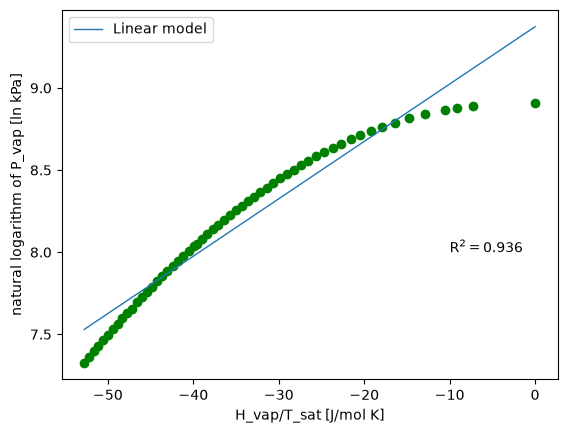
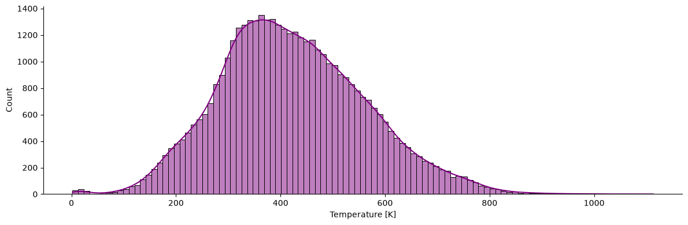
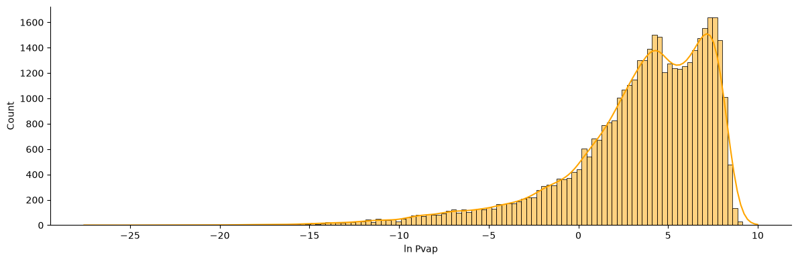
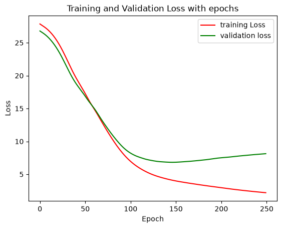

# Report: Deep Neural Network for VLE Prediction

Running log of the project. Sections are filled in as the work progresses.

## 1. Objective

Build a deep neural network in PyTorch that predicts the vapor pressure of pure compounds from their molecular structure (fingerprints) and temperature, and test it on compounds it has never seen. Before building the network, Part 1 uses CO2 data to show why mechanistic knowledge should not be bypassed when modelling in chemical engineering.

## 2. Background

**Vapor-liquid equilibrium and vapor pressure.** Along the coexistence curve a pure substance has liquid and vapor in equilibrium, so vapor pressure is a function of temperature alone.

**Critical point.** The coexistence curve ends at the critical point $(T_c, P_c)$. As it is approached, the liquid and vapor densities converge and the enthalpy of vaporization goes to zero, $\Delta H_{vap} \to 0$. Above $T_c$ there is a single supercritical fluid.

**Clapeyron and Clausius-Clapeyron equations.** Along the coexistence curve, the exact Clapeyron equation is

$$
\frac{dP}{dT} = \frac{\Delta H_{vap}}{T \, \Delta V}
$$

Assuming a negligible liquid volume, an ideal-gas vapor and a constant $\Delta H_{vap}$ gives the Clausius-Clapeyron equation:

$$
\ln P = -\frac{\Delta H_{vap}}{R T} + c
$$

so $\ln P$ against $1/T$ is a straight line with slope $-\Delta H_{vap}/R$. These assumptions fail near the critical point, and $\Delta H_{vap}$ is in fact a function of temperature (it decreases non-linearly and reaches zero at $T_c$), so a fit to this equation gives only an average, approximate $\Delta H_{vap}$.

**Deep neural networks.** _To fill in when Part 2 is reached._

## 3. Part 1: CO2 phase envelope

### 3.1 Data and exploration

The CO2 vapor-liquid data come from the CRC Handbook of Chemistry and Physics and Lange's Handbook of Chemistry. The columns are temperature (`T [C]`), vapor pressure (`P_vap [kPa]`), heat of vaporization (`H_vap [J/g]`), and vapor and liquid densities (`rho_vap`, `rho_liq` in g/cm3).

- The dataset has 72 rows. `H_vap` and `rho_vap` are missing in 15 of them, so these rows were removed, leaving 57.
- The row where `H_vap = 0` is the critical point, at about 31.1 °C and 7391 kPa, and it is also the maximum temperature in the dataset.

_Add your scatter plots of P_vap vs T and H_vap vs T here._

### 3.2 Linear baseline: P vs T

A linear regression of $P_{vap}$ on $T$ was fitted as a baseline.

- $R^2 =$ _0.975_
- RMSE $=$ _4311.08_ kPa

__ The data are clearly curved while the model is a straight line, so the fit is poor at both ends of the temperature range.

### 3.3 Using physics: ln P vs 1/T

Using the Clausius-Clapeyron form, $\ln P$ was regressed on $1/T$, with temperature converted to Kelvin ($T + 273.15$).

- $R^2 =$ _1.0_ (unrounded)
- RMSE $=$ _0.0060_ ln(kPa)
- Slope $=$ _-1953.98_, which corresponds to $-\Delta H_{vap}/R$
- Intercept $=$ _15.31_

__ The points fall almost exactly on a straight line, in contrast with the baseline.

### 3.4 Using the measured enthalpy: ln P vs -ΔH_vap/T

The measured $H_{vap}$ at each temperature was converted to J/mol (multiplied by the molar mass of CO2, 44.01 g/mol) and divided by the temperature in Kelvin. $\ln P$ was then regressed on $-\Delta H_{vap}/T$.

- $R^2 = 0.936$
- RMSE $=$ _0.118_ ln(kPa)
- Slope $=$ _0.034_ (for a constant $\Delta H_{vap}$ it would be $1/R \approx 0.12$ mol K/J)
- Intercept $=$ _9.37_

_._ The points curve away from the fitted line, and the fit is worse than the $\ln P$ vs $1/T$ fit.

### 3.5 Observations

- Transforming the variables according to the physics ($\ln P$ and $1/T$) turned a poor linear fit into an almost perfect one, with the same simple model.
- Even with this simple model, the choice of variables matters more than the model itself: the three fits use the same linear regression but give very different results.
- The largest deviation in the $-\Delta H_{vap}/T$ plot is at the high-temperature end (toward the critical point, where $\Delta H_{vap} \to 0$). _Your interpretation: why does the fit break down there, and which assumption of Clausius-Clapeyron fails?_
- _Your interpretation: how does the fitted slope in 3.4 compare with $1/R$, and what does that say about the equation's assumptions?_
- Lesson: $R^2$ and RMSE must be computed with the predictions at the real data points compared with the measured values, not on the points of the fitted line. Scoring the model on its own predictions gives a meaningless $R^2 = 1$.

### 3.6 Note on data splitting

All three fits use the full 57-point dataset for both fitting and evaluation, with no train/test split. This is acceptable here because the models have only two parameters and the goal is to compare the choice of variables, but the reported $R^2$ and RMSE describe fit quality on the data used for fitting, not performance on unseen data. A proper split is introduced in Part 2.

## 4. Part 2: Vapor pressure of many compounds

### 4.1 Data and exploration

The dataset contains vapor pressures of many compounds from the Korean Data Bank. Each row is one measurement, with the compound name, CAS number, formula, SMILES string, temperature `T` (in K), vapor pressure `Pvap` (in kPa), and the chemical class and subclass.

- Each compound has measurements at several temperatures, so there are many more rows than compounds. _Add your counts: number of rows, number of unique compounds (the tutorial reports 1391), classes (17) and subclasses (53)._
- **Temperature.** The distribution is roughly bell-shaped, peaking at about 350 to 400 K, with most data between about 200 and 700 K. The skewness is 0.32, so it is approximately symmetric with a slightly longer right tail (out to about 1100 K). A small group of rows lies at very low temperatures (about 0 to 30 K).
- **Vapor pressure.** The raw distribution is extremely right-skewed (skewness 3.3): most values are close to zero with a long tail up to about 22,000 kPa.

[Pressure Hist](image-5.png)

### 4.2 Molecular fingerprints (SMILES to features)

Each compound's SMILES string is converted into a molecular fingerprint: a vector of 2048 bits in which each bit marks the presence (1) or absence (0) of a substructure. The fingerprint depends only on the structure, so a compound has the same fingerprint at every temperature. It tells the model which compound's curve it is on, and temperature tells it where on that curve.

The model input is the fingerprint plus the scaled temperature (2049 features). 

### 4.3 Log scaling of vapor pressure

Following the Clausius-Clapeyron form, the target is $\ln P_{vap}$ instead of $P_{vap}$.

| | Skewness |
|---|---|
| $P_{vap}$ (raw) | 3.3 |
| $\ln P_{vap}$ | -1.57 |

- The log compresses a range of about 0 to 22,000 kPa to about -27 to 10, making the bulk of the data visible.
- The skew changes direction: instead of a long right tail, there is a long left tail of very low pressures. The distribution is also bimodal, with peaks near 4 and 7.
- It is still skewed, so the transformation is not expected to make the target normal. Its purpose is to compress the range and match the physics.
- Few data points lie at very low $\ln P$, so errors there may be larger. _To check when evaluating the model._

_Add the $\ln P$ histogram here._

### 4.4 Train / validation / test split

The data is split **by compound**, not by row. Each compound has measurements at many temperatures and one fixed fingerprint, so a random row split would put the same molecule in both train and test, and the test score would not show how the model handles new molecules.

- The split is stratified by chemical class: within each of the 17 classes, the compounds are divided 80/20 into train+validation and test, and then the train+validation part is divided 80/20 into train and validation. Every class is therefore represented in all three sets.
- The split is done on the list of unique compound names, and then every row of each compound follows it.

| Set | Rows |
|---|---|
| Train | 26,310 |
| Validation | 6,810 |
| Test | 8,610 |
| Total | 41,730 |

The sets hold about 63%, 16% and 21% of the rows. They differ slightly from 64/16/20 because compounds have different numbers of temperature points.

The temperature is standardized with a scaler fitted on the training set only, then applied to all three sets, to avoid data leakage.

_Add your check that no compound appears in more than one set, and that all classes are in each set._

### 4.5 Neural network model

**Inputs and target**
- $X$ = fingerprint (2048 bits) plus scaled temperature, giving 2049 features per row.
- $y$ = $\ln P_{vap}$, as a column of shape $(n, 1)$.

| | $X$ shape | $y$ shape |
|---|---|---|
| Train | (26310, 2049) | (26310, 1) |
| Validation | (6810, 2049) | (6810, 1) |
| Test | (8610, 2049) | (8610, 1) |

**Architecture** (PyTorch, a class inheriting from `nn.Module`)

Linear(2049 → 20) → ReLU → Linear(20 → 20) → ReLU → Linear(20 → 1)

- Two hidden layers of 20 neurons each, with ReLU activations.
- No activation on the output layer, because $\ln P$ can be any real number.
- Trainable parameters: $(2049 \times 20 + 20) + (20 \times 20 + 20) + (20 \times 1 + 1) = 41{,}441$.

_Note: an early version of the class had a naming mistake (the third layer was assigned to `layer_1` and overwrote the first one), which gave only 441 parameters. Counting the parameters caught it._

### 4.6 Training and overfitting

- Loss function: mean squared error. Optimizer: _your optimizer and learning rate (the tutorial uses Adam, 0.002)_.
- Trained for 250 epochs on CPU, using the full training set in each epoch.

__

**Observations**
- Both losses start at about 27 and decrease together for roughly the first 60 epochs.
- The validation loss reaches its minimum of about 7 near epoch 145 and then slowly rises to about 8 by epoch 250, while the training loss keeps falling to about 2.
- This growing gap is **overfitting**: after about epoch 145 the network is learning the training compounds rather than patterns that carry over to unseen compounds.
- The remedy is early stopping, which stops training when the validation loss stops improving and restores the weights from the best epoch.

### 4.7 Early stopping

The 250-epoch run showed overfitting. The training loss kept falling, but the validation loss reached its minimum (about 7) near epoch 145 and then rose.

Early stopping was added to the training loop:
- The **validation loss** is checked after every epoch.
- A new best value saves a copy of the model weights (`copy.deepcopy(model.state_dict())`) and resets a counter. Otherwise the counter increases.
- Training stops when the counter reaches the **patience**, 30 epochs.
- The weights from the best epoch are loaded back, so the final model is the best one and not the last one.

With patience 30, the hidden size 20 network stopped at epoch 178, and the best epoch was about 148 (validation loss about 7.3). This is consistent with the minimum seen in the full run.

_Add the loss plot with early stopping here._

**Mistakes made and fixed**
- Reusing the model from a previous run meant training started from overfit weights. Each run needs a freshly created model, optimizer and stopper.
- Passing the old model's parameters to the optimizer left the new model's weights unchanged and gave a flat loss. The model, the optimizer and the stopper must all refer to the same network.

### 4.8 Hyperparameter tuning

The hidden size (neurons per hidden layer) was tuned over 3, 10, 20 and 50, with the two-hidden-layer architecture kept fixed. Every size started from a fresh model with the same seed, and was trained with the same learning rate (0.002), patience (30) and maximum of 250 epochs. Each size was judged on the **validation set** at its best epoch. The test set was not used.

**Choice of metrics**

MAE and RMSE, both computed on $\ln P_{vap}$, were chosen as the primary metrics. MAPE, used in the book, was kept as a secondary metric only.

- The target is $\ln P$, which takes both negative and positive values and crosses zero. MAPE divides each error by the true value, so rows with $\ln P$ close to zero give huge percentage errors that dominate the average.
- MAE and RMSE are in $\ln P$ units, so they have a direct meaning: an error of 1 corresponds to a factor of $e \approx 2.7$ in the pressure, wherever on the scale the point is.
- RMSE penalizes large errors more than MAE does, so using both shows whether errors are evenly spread or concentrated.
- The results confirm the problem with MAPE: it ranks size 50 last, while MSE, MAE and RMSE all rank it first.

**Results (validation set, best epoch)**

| Hidden size | Parameters | Stopped at epoch | Best epoch | Val MSE | Val MAE | Val RMSE | Val MAPE (%) |
|---|---|---|---|---|---|---|---|
| 3 | 6,166 | 249 | 249 | 11.19 | 2.514 | 3.345 | 122.7 |
| 10 | 20,621 | 226 | 196 | 6.92 | 1.878 | 2.630 | 107.0 |
| 20 | 41,441 | 176 | 146 | 6.82 | 1.865 | 2.612 | 107.6 |
| 50 | 105,101 | 189 | 159 | 6.21 | 1.713 | 2.492 | 135.3 |

**Observations**
- Hidden size 50 is best by MSE, MAE and RMSE, and was selected.
- Size 3 never triggered early stopping (best epoch 249): it was still improving at the 250-epoch limit, so it is underfit.
- Sizes 10 and 20 are nearly identical. The differences between them are small and probably within the variation caused by random initialization, since each size was run with a single seed.
- For comparison, the book's version trains every size for the full 250 epochs and ranks them by validation MAPE, which selected size 10 (validation MAPE 101.7).

### 4.9 Test performance

The selected model (hidden size 50, best-epoch weights) was evaluated **once** on the test set, which contains compounds that were not seen in training or validation.

| Metric | Validation | Test |
|---|---|---|
| MAE | 1.713 | 1.634 |
| RMSE | 2.492 | 2.516 |
| $R^2$ | not computed | 0.642 |
| MAPE (secondary) | 135.3% | 146.6% |

**Observations**
- Test and validation errors agree closely, so the selection of the hidden size and the early stopping did not overfit the validation set.
- A typical error is 1.63 in $\ln P$, which is a factor of about $e^{1.63} \approx 5$ in the pressure. The model explains about 64% of the variance in $\ln P$ for unseen compounds: useful for rough estimates, but not accurate enough for design calculations.
- RMSE (2.52) is much larger than MAE (1.63), so a minority of predictions have very large errors.

_Error analysis to add: absolute error by chemical class, and a parity plot of predicted against true $\ln P$ (does the error concentrate at very low pressures, where there is little data?)._

### 4.10 Error analysis

The test errors are not evenly spread: the RMSE (2.52) is much larger than the MAE (1.63), so a minority of predictions carry very large errors. Details (parity plot, error against temperature, by chemical class, by pressure range) are in [ERROR_ANALYSIS.md](ERROR_ANALYSIS.md).

- The model is accurate in the dense middle of the data (about 84% of test rows have true $\ln P$ between 0 and 10, with MAE 1.2 to 1.6).
- Errors grow at very low pressures and temperatures, where there is little training data, and the model over-predicts the lowest pressures.
- By class, Naphthenic Hydrocarbons, Ketones and Ethers are predicted best (MAE below 1.1), and Inorganics, Amides and Acids worst (MAE 2.4 to 4.8).
- This supports adding a similarity-based warning to the planned app, so users know when a prediction is outside the region the model was trained on.

## 5. Extensions: Comparison with tree-based models

Tree-based regressors were fitted on the same inputs as the neural network (2048-bit fingerprint plus scaled temperature) and the same split by compound, to check whether the network is the best choice for this problem. Trees need no feature scaling, and the input was left as it was.

### 5.1 Setup

- **Models:** Decision Tree, Random Forest (`RandomForestRegressor`) and XGBoost (`XGBRegressor`), all with scikit-learn or library **default settings** and `random_state=42`. The target is $\ln P_{vap}$ (passed as a 1-D array).
- **Selection:** the models were compared on the fixed **validation set** (compounds not used for fitting), using MAE and RMSE on $\ln P$ as the primary metrics, as for the network. The test set was not used.
- **Planned tuning:** the best model will be tuned with `RandomizedSearchCV` and `GroupKFold` on the training set, with the compound name as the group, so that no compound appears in both the fitting and validation folds of a split. Ordinary k-fold would put rows of the same compound (which share one fingerprint) on both sides and reward memorizing molecules.

### 5.2 Results with default settings (validation set)

The DNN row was computed by loading the saved model (`models/dnn_vle.pt`) and passing it through the same metric function as the other models. Its validation MAE (1.713) and RMSE (2.492) reproduce the values from the hidden-size search, which confirms the saved model and the data preparation are consistent between notebooks.

| Model | Valid MAE | Valid RMSE | Valid $R^2$ | Train MAE | Train RMSE | Train $R^2$ | Fit time (s) |
|---|---|---|---|---|---|---|---|
| **XGBoost** | **1.323** | **2.110** | **0.735** | 0.783 | 1.339 | 0.902 | 4.5 |
| Random Forest | 1.437 | 2.255 | 0.698 | 0.315 | 0.582 | 0.981 | 190 |
| DNN (hidden size 50) | 1.713 | 2.492 | 0.631 | 0.741 | 1.360 | 0.898 | not measured |
| Decision Tree | 1.745 | 2.742 | 0.553 | 0.002 | 0.071 | 0.9997 | 8 |

Fit times are rough: repeating the same fits gave different times (for example 41 s and 8 s for the decision tree, and 252 s and 190 s for the forest), since they depend on what else the machine is doing. The times shown are from the second run.

### 5.3 Observations

- **XGBoost is best** on all validation metrics and is also the fastest of the ensembles to fit (a few seconds, against minutes for the forest), which makes it the practical choice to tune.
- **The default decision tree overfits completely:** its training MAE is 0.002 against a validation MAE of 1.745. Averaging many trees reduces this (Random Forest: 1.437), and boosting reduces it further (XGBoost: 1.323).
- **The DNN and XGBoost fit the training data about equally well** (training $R^2$ 0.898 and 0.902; training MAE 0.74 and 0.78), but XGBoost generalizes better to unseen compounds (validation MAE 1.32 against 1.71). The train-to-validation gap in MAE is about 0.97 for the DNN and 0.54 for XGBoost.
- **Ranking by validation MAE:** XGBoost, Random Forest, DNN, Decision Tree. The network, with 105,101 parameters and a tuned size, performs between the forest and the single tree, and an untuned XGBoost beats it on MAE, RMSE and $R^2$.
- **Caveats:** these are single runs on one validation split with default settings, so small differences (for example between Random Forest and XGBoost) may be within the variation from the split. The network's size was tuned on this same validation set, while the tree models were not tuned at all, so the comparison, if anything, favors the network.

_Open question to check: the decision tree's training RMSE (0.071) is far above its training MAE (0.002), so a few training rows are not fitted exactly. One possible reason is that different compounds with the same fingerprint and temperature cannot be separated by the tree (not tested)._

### 5.4 Next steps

1. Tune XGBoost with `GroupKFold` on the training set, and check the tuned model on the validation set.
2. Evaluate all models **once** on the test set, in one table, after the choice has been made.

## 6. Conclusions and lessons learned

_To fill in._

## 7. References

- Sanchez Medina, E. I., del Rio Chanona, A., Ganzer, C. *Machine Learning in Chemical Engineering*, tutorial 4: Deep Neural Networks for VLE prediction. https://edgarsmdn.github.io/MLCE_book/04_DNN_VLE.html
- Haynes, W. M. *CRC Handbook of Chemistry and Physics*, 2016.
- Speight, J. G. *Lange's Handbook of Chemistry*, 2017.
