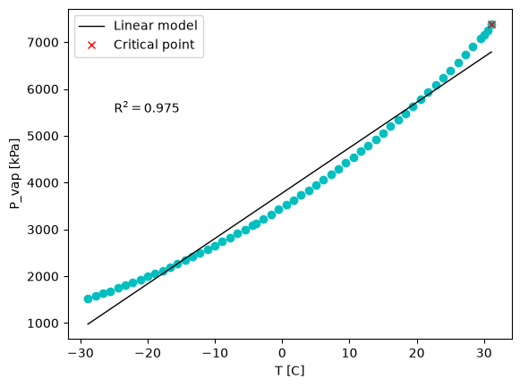
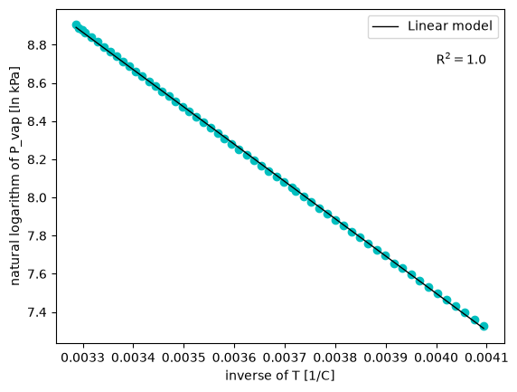

# Report: Deep Neural Network for VLE Prediction

Running log of the project. Sections are filled in as the work progresses.

## 1. Objective

Build a deep neural network in PyTorch that predicts the vapor pressure of pure compounds from their molecular structure (fingerprints) and temperature, and test it on compounds it has never seen. Before building the network, Part 1 uses CO2 data to show why mechanistic knowledge should not be bypassed when modelling in chemical engineering.

## 2. Background

**Vapor-liquid equilibrium and vapor pressure.** Along the coexistence curve a pure substance has liquid and vapor in equilibrium, so vapor pressure is a function of temperature alone.

**Critical point.** The coexistence curve ends at the critical point $(T_c, P_c)$. As it is approached, the liquid and vapor densities converge and the enthalpy of vaporization goes to zero, $\Delta H_{vap} \to 0$. Above $T_c$ there is a single supercritical fluid.

**Clapeyron and Clausius-Clapeyron equations.** Along the coexistence curve, the exact Clapeyron equation is

$$
\frac{dP}{dT} = \frac{\Delta H_{vap}}{T \, \Delta V}
$$

Assuming a negligible liquid volume, an ideal-gas vapor and a constant $\Delta H_{vap}$ gives the Clausius-Clapeyron equation:

$$
\ln P = -\frac{\Delta H_{vap}}{R T} + c
$$

so $\ln P$ against $1/T$ is a straight line with slope $-\Delta H_{vap}/R$. These assumptions fail near the critical point, and $\Delta H_{vap}$ is in fact a function of temperature (it decreases non-linearly and reaches zero at $T_c$), so a fit to this equation gives only an average, approximate $\Delta H_{vap}$.

**Deep neural networks.** _To fill in when Part 2 is reached._

## 3. Part 1: CO2 phase envelope

### 3.1 Data and exploration

The CO2 vapor-liquid data come from the CRC Handbook of Chemistry and Physics and Lange's Handbook of Chemistry. The columns are temperature (`T [C]`), vapor pressure (`P_vap [kPa]`), heat of vaporization (`H_vap [J/g]`), and vapor and liquid densities (`rho_vap`, `rho_liq` in g/cm3).

- The dataset has 72 rows. `H_vap` and `rho_vap` are missing in 15 of them, so these rows were removed, leaving 57.
- The row where `H_vap = 0` is the critical point, at about 31.1 °C and 7391 kPa, and it is also the maximum temperature in the dataset.

_Add your scatter plots of P_vap vs T and H_vap vs T here._

### 3.2 Linear baseline: P vs T

A linear regression of $P_{vap}$ on $T$ was fitted as a baseline.

- $R^2 =$ _0.975_
- RMSE $=$ _4311.08_ kPa

__ The data are clearly curved while the model is a straight line, so the fit is poor at both ends of the temperature range.

### 3.3 Using physics: ln P vs 1/T

Using the Clausius-Clapeyron form, $\ln P$ was regressed on $1/T$, with temperature converted to Kelvin ($T + 273.15$).

- $R^2 =$ _1.0_ (unrounded)
- RMSE $=$ _0.0060_ ln(kPa)
- Slope $=$ _-1953.98_, which corresponds to $-\Delta H_{vap}/R$
- Intercept $=$ _15.31_

__ The points fall almost exactly on a straight line, in contrast with the baseline.

### 3.4 Using the measured enthalpy: ln P vs -ΔH_vap/T

The measured $H_{vap}$ at each temperature was converted to J/mol (multiplied by the molar mass of CO2, 44.01 g/mol) and divided by the temperature in Kelvin. $\ln P$ was then regressed on $-\Delta H_{vap}/T$.

- $R^2 = 0.936$
- RMSE $=$ _0.118_ ln(kPa)
- Slope $=$ _0.034_ (for a constant $\Delta H_{vap}$ it would be $1/R \approx 0.12$ mol K/J)
- Intercept $=$ _9.37_

_Add the plot here._ The points curve away from the fitted line, and the fit is worse than the $\ln P$ vs $1/T$ fit.

### 3.5 Observations

- Transforming the variables according to the physics ($\ln P$ and $1/T$) turned a poor linear fit into an almost perfect one, with the same simple model.
- Even with this simple model, the choice of variables matters more than the model itself: the three fits use the same linear regression but give very different results.
- The largest deviation in the $-\Delta H_{vap}/T$ plot is at the high-temperature end (toward the critical point, where $\Delta H_{vap} \to 0$). _Your interpretation: why does the fit break down there, and which assumption of Clausius-Clapeyron fails?_
- _Your interpretation: how does the fitted slope in 3.4 compare with $1/R$, and what does that say about the equation's assumptions?_
- Lesson: $R^2$ and RMSE must be computed with the predictions at the real data points compared with the measured values, not on the points of the fitted line. Scoring the model on its own predictions gives a meaningless $R^2 = 1$.

### 3.6 Note on data splitting

All three fits use the full 57-point dataset for both fitting and evaluation, with no train/test split. This is acceptable here because the models have only two parameters and the goal is to compare the choice of variables, but the reported $R^2$ and RMSE describe fit quality on the data used for fitting, not performance on unseen data. A proper split is introduced in Part 2.

## 4. Part 2: Vapor pressure of many compounds

### 4.1 Data and exploration

### 4.2 Molecular fingerprints (SMILES to features)

### 4.3 Log scaling of vapor pressure

### 4.4 Train / validation / test split

### 4.5 Neural network model

### 4.6 Training and overfitting

### 4.7 Early stopping

### 4.8 Hyperparameter tuning

### 4.9 Test performance

## 5. Extensions

_To fill in._

## 6. Conclusions and lessons learned

_To fill in._

## 7. References

- Sanchez Medina, E. I., del Rio Chanona, A., Ganzer, C. *Machine Learning in Chemical Engineering*, tutorial 4: Deep Neural Networks for VLE prediction. https://edgarsmdn.github.io/MLCE_book/04_DNN_VLE.html
- Haynes, W. M. *CRC Handbook of Chemistry and Physics*, 2016.
- Speight, J. G. *Lange's Handbook of Chemistry*, 2017.
